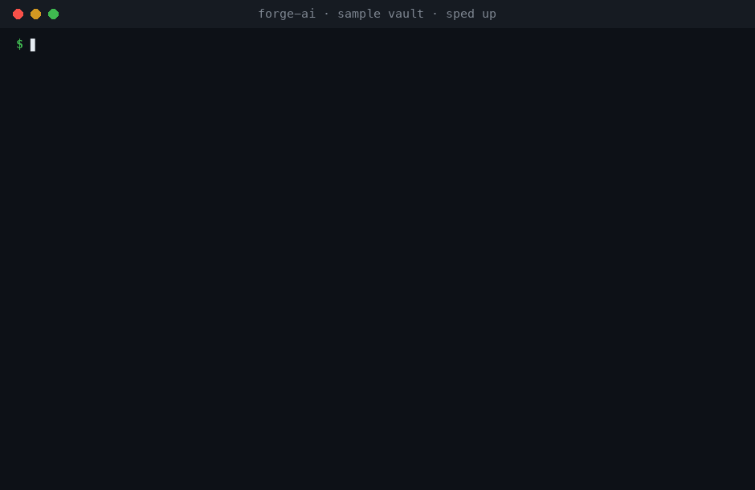

# 🧠 Forge AI

[](https://github.com/milesgurule-png/forge-ai/actions/workflows/test.yml)  



**A private AI assistant that runs entirely on your own computer** and can answer questions from your Obsidian notes, with citations. No cloud, no API costs.

Built by [Miles Gurule](https://github.com/milesgurule-png) as part of Forge Labs.

## What it does
- **`chat.py`**: a fast terminal chat with a local open-weight model through [Ollama](https://ollama.com). It streams replies and uses only the Python standard library.
- **`vault_brain.py`**: RAG ("retrieval-augmented generation") over an Obsidian vault:
  - `index`: splits notes by heading, embeds them locally, and stores them in SQLite. Re-runs are incremental.
  - `ask "question"`: answers from your notes and cites them as `[[note names]]`. It also flags any citation that wasn't actually retrieved.
    Add `--json` to get one JSON object (answer, citations, sources, chunks, timing) for scripts and other tools.
  - `links "Note"`: finds notes in other folders that are similar but not yet linked.
  - `suggest`: the top unlinked cross-folder note pairs across the whole vault.
  - `stats`: index size and notes per folder.

## Requirements
- macOS or Linux with Python 3.9+
- [Ollama](https://ollama.com) with two models (about 8 GB total):
  ```
  ollama pull qwen3.5:9b
  ollama pull qwen3-embedding:0.6b
  ```
  Tested on an Apple M4 with 16 GB RAM: about 23 tokens/second on Ollama's MLX engine.

## Use
```
python3 chat.py
FORGE_VAULT=~/path/to/your/vault python3 vault_brain.py index
FORGE_VAULT=~/path/to/your/vault python3 vault_brain.py ask "What do my notes say about pricing?"
FORGE_VAULT=~/path/to/your/vault python3 vault_brain.py links "Some Note"
```
Environment options: `FORGE_VAULT` (vault folder), `FORGE_DB` (index file), `FORGE_MODEL`, `FORGE_EMBED_MODEL`, `OLLAMA_HOST`.

## Roadmap
1. ✅ Pick an Apache-2.0 base model that fits on a laptop
2. ✅ Local chat
3. ✅ Vault brain (RAG with citations, link suggestions)
4. ⏳ Tool use (search the vault, draft notes)
5. ⏳ LoRA fine-tuning with MLX
6. ⏳ Evaluations and a model card

## License
Apache-2.0. See [LICENSE](LICENSE).

## Tests

The parsing, chunking, vector math and citation checks are covered by unit tests that run without Ollama:

```bash
python3 -m unittest discover -s tests -v
```
